<h1 align="center">Hi there, I’m Grant Hur (Gran4) 👋</h1>
<h3 align="center">Python Developer | AI Enthusiast</h3>

## Grant Hur | Python Developer | AI Enthusiast

Hi there! 👋 I'm Grant Hur, a Python developer interested in using AI to improve my workflow. My work includes the ASDRP iOS app and my personal website. Some of my projects are internal and are not publicly available.

### 🤝 Let's connect

 

<strong>📬 Connect</strong>

<strong>😄 About Me </strong>

- 📍 Location: San Jose, CA, US
- 🌱 Projects include the ASDRP iOS app and my personal website: [asdrp-website.onrender.com/resume](https://asdrp-website.onrender.com/resume)
- 🔒 Some projects are internal and are not publicly available
- 🧠 Experience with Python, C, C++, Java, and iOS development
- 🏆 Won first place in Lockheed Martin’s Code Quest coding competition in 2024
- 🏅 Won my ASDRP group’s personal website challenge with my site: [asdrp-website.onrender.com/resume](https://asdrp-website.onrender.com/resume)
- ⚽️ I play soccer

<strong>📈 GitHub Stats</strong>

<strong>Skills</strong>

<strong>🏗️ Projects </strong>

#### ASDRP iOS App

An internal student platform that brings deadlines, attendance, forms, and profile discovery together to help organize lab communication.

#### [Personal Website](https://asdrp-website.onrender.com/resume)

A portfolio showcasing my ASDRP work and personal projects, with an interactive timeline, mobile-friendly Kitchen Notes, and a downloadable one-page résumé.

